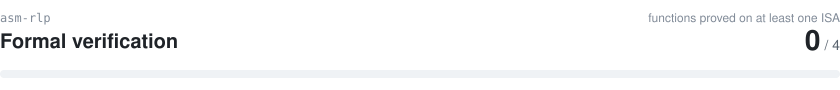

# asm-rlp

Recursive-Length Prefix (RLP) for Ethereum, in assembly.

Standard: [asm-standard@185917b](https://github.com/bitminetech/asm-standard/blob/185917bedc54ff034e40069318add463c58f4db8/ARCHITECTURE.md)

<!-- CI generates the verification heatmap here. -->
<table><tr><td>

<picture><source media="(prefers-color-scheme: dark)" srcset="docs/heatmap/header-dark.svg"></picture>

<picture><source media="(prefers-color-scheme: dark)" srcset="docs/heatmap/label-rlp-dark.svg"></picture><a href="docs/reference/rlp.md#function-rlp_decode"><picture><source media="(prefers-color-scheme: dark)" srcset="docs/heatmap/cell-0-dark.svg"></picture></a><a href="docs/reference/rlp.md#function-rlp_encode_size"><picture><source media="(prefers-color-scheme: dark)" srcset="docs/heatmap/cell-0-dark.svg"></picture></a><a href="docs/reference/rlp.md#function-rlp_encode"><picture><source media="(prefers-color-scheme: dark)" srcset="docs/heatmap/cell-0-dark.svg"></picture></a><a href="docs/reference/rlp.md#function-rlp_measure"><picture><source media="(prefers-color-scheme: dark)" srcset="docs/heatmap/cell-0-dark.svg"></picture></a>

<picture><source media="(prefers-color-scheme: dark)" srcset="docs/heatmap/legend-dark.svg"></picture>

</td></tr></table>
<!-- End of the verification heatmap. -->

## Reference

| File | Covers |
|---|---|
| [docs/reference/rlp.md](docs/reference/rlp.md) | Encode and decode |
| [include/rlp.inc](include/rlp.inc) | Constants |

## Targets

| OS | ISAs |
|---|---|
| Linux | x86-64, ARM64, RISC-V |
| Windows | x86-64, ARM64 |
| macOS | x86-64, ARM64 |

## Build tools

| Used for | Tool |
|---|---|
| Library | LLVM 23.1.5, official release (`clang`, `llvm-ar`, `lld`) |
| Windows test runner and bench | [llvm-mingw 20261104](https://github.com/mstorsjo/llvm-mingw/releases/tag/20261104) (LLVM 23.1.5) |
| macOS test runner and bench | The host Xcode clang, because it needs the macOS SDK |
| Build image | [platform/linux/Dockerfile](platform/linux/Dockerfile) on `debian:trixie-slim@sha256:a72b4433de1cf7d6bae0c4cee74d0547f58601a643b3375f070c51600d63b6b2` |

## Tests

| Item | Location |
|---|---|
| Export and frame check | [platform/check.py](platform/check.py) |
| Vector generator | [tests/generator/](tests/generator/) |
| Test runner | [tests/runner/](tests/runner/) |
| Bench | [bench/](bench/) |

## Target profile

| ISA | Instructions |
|---|---|
| x86-64 | x86-64-v1 |
| ARM64 | Armv8.0-A |
| RISC-V | RV64GC |

| Item | Value |
|---|---|
| macOS objects | Marked for macOS 11.0 or later |

## Stack

| Item | Value |
|---|---|
| Stack per call | At most 128 bytes, callees included |

## Benchmark machines

| ISA | CPU |
|---|---|
| x86-64 | The CPU of the GitHub runners `ubuntu-24.04`, `windows-2025` and `macos-15-intel`. Each bench run prints it. |
| ARM64 | The CPU of the GitHub runners `ubuntu-24.04-arm`, `windows-11-arm` and `macos-15`, and Apple M series Macs. Each bench run prints it. |
| RISC-V | Run only, under QEMU on `ubuntu-24.04-arm`. Its times are not measurements. |
